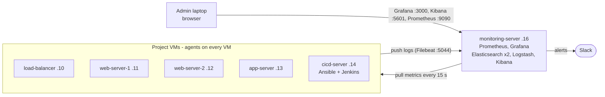
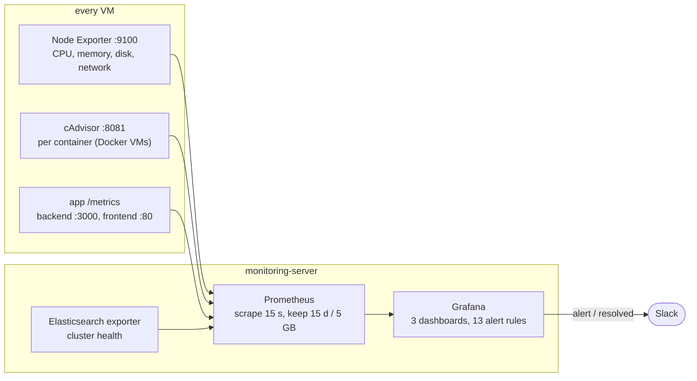
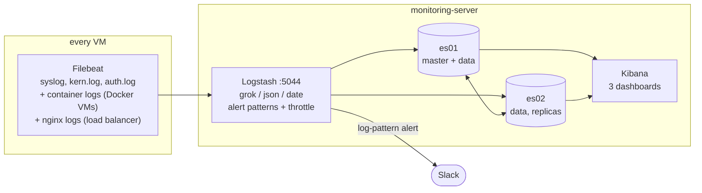
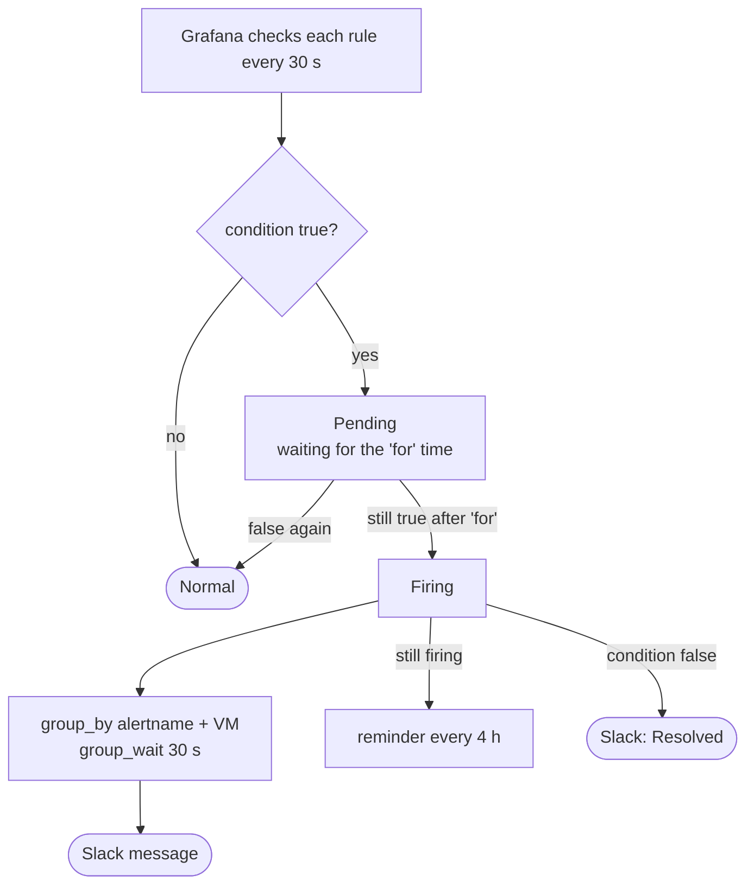
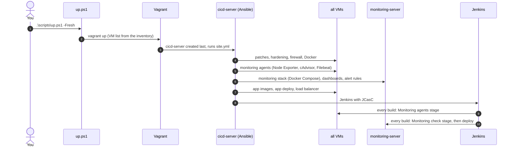

# Architecture — Sherlock Logs

How monitoring, logging and alerting fit into the infrastructure.
GitHub and Gitea render the Mermaid diagrams directly.

## 1. VMs and data flows

**Why a separate VM:** monitoring must keep working when an app VM is overloaded or down.
If Prometheus ran on the web server it watches, a frozen web server would also freeze
its own alarm.

**Metrics are pulled, logs are pushed.** Prometheus decides when to collect metrics, so a
missing VM shows up at once as a DOWN target. Logs are written all the time, so the VM
itself (Filebeat) sends them as they come, and Filebeat resends anything Logstash missed.

## 2. Metrics path

**17 scrape targets:** Node Exporter on 7 VMs, cAdvisor on 5 Docker VMs, the backend, the
2 frontends, the Elasticsearch exporter and Prometheus itself.

**The target list is generated from the inventory** (`prometheus.yml.j2`). Add a VM to
`ansible/inventory/hosts.yml`, and the next Ansible run or Jenkins build adds its agents
and its targets.

**cAdvisor and Docker 29:** cAdvisor 0.49.1 can't read Docker 29's new containerd image
store, so Docker is set to the classic overlay2 store (`/etc/docker/daemon.json`,
`"containerd-snapshotter": false`). See the notes, incident 12.

## 3. Logs path

**What Logstash does** (`logstash.conf.j2`):
1. **Parse** — `grok` splits system and nginx lines into fields, `json` reads the app's
   JSON logs, `date` uses the time written in the line.
2. **Route** — one index per type and day: `system-logs-*`, `app-logs-*`, `docker-logs-*`.
3. **Match** — `if` + regex: `Failed password|Invalid user` in auth logs, or level
   `ERROR`/`CRITICAL`, gets the tag `log_alert`.
4. **Throttle** — at most one Slack message per VM and alert type every 5 minutes.
5. **Output** — every line to Elasticsearch; alert lines also to Slack (`http` output).

A line that can't be parsed is **never dropped**: it is stored with a tag such as
`_syslog_parse_failure`, so it can be found in Kibana (`tags : *_failure`).

**Two Elasticsearch nodes:** every index has 1 replica, kept on the other node. Stop es02
and the cluster turns **yellow**: all data is still on es01, just not twice. es02 is not
master-eligible, so the cluster never has to vote between two equal masters.

**Retention:** an ILM policy deletes log indices older than 14 days. Elasticsearch is
bound to the VM's loopback (127.0.0.1) — only Logstash, Kibana and the exporter use it.

## 4. Alerts

- **Pending:** the problem was seen, the rule waits to make sure it's real.
- **Firing:** the problem lasted the whole wait time; Slack gets the message.

Every rule has a **severity** label (info, warning, critical). It appears at the end of the
Slack title, e.g. *(Sherlock Logs critical)*. All alerts go to one Slack channel; in a bigger
team, critical alerts would get their own route to an on-call tool (escalation).

## 5. Automation flow

**Order matters:** the agents come right after Docker, and the monitoring stack comes
before the app, so the first deploy is already monitored.

**Dynamic agent configuration:** the inventory says what each VM is, and Ansible builds
each VM's config from it:
- cAdvisor goes only to the `docker_hosts` group (`monitoring-agents.yml`).
- `filebeat.yml.j2` adds container logs only on Docker VMs and nginx logs only on the
  load balancer (``).
- Filebeat's Logstash address is `monitoring_ip`, read from the inventory
  (`group_vars/all/vars.yml`), not a fixed IP.

## 6. Ports (UFW, deny by default)

| To | Port | Allowed from | What |
|---|---|---|---|
| every VM | 9100 | monitoring-server | Node Exporter |
| Docker VMs | 8081 | monitoring-server | cAdvisor |
| web servers | 80 | load-balancer, monitoring-server | frontend (+ `/metrics`) |
| app-server | 3000 | web servers, monitoring-server | backend (+ `/metrics`) |
| monitoring-server | 3000, 5601, 9090 | admin laptop | Grafana, Kibana, Prometheus |
| monitoring-server | 5044 | all project VMs | Filebeat → Logstash |
| monitoring-server | 9200 / 9201 | — (loopback only) | Elasticsearch |
| every VM | 22 | admin laptop, cicd-server (+ backup-server in bonus mode) | SSH |
| load-balancer | 80 | anyone | the app (the public entry point) |
| cicd-server | 8080 | admin laptop | Jenkins |

The containers run with `network_mode: host`. With published ports, Docker writes its own
iptables rules and bypasses UFW; host networking keeps UFW in charge.
